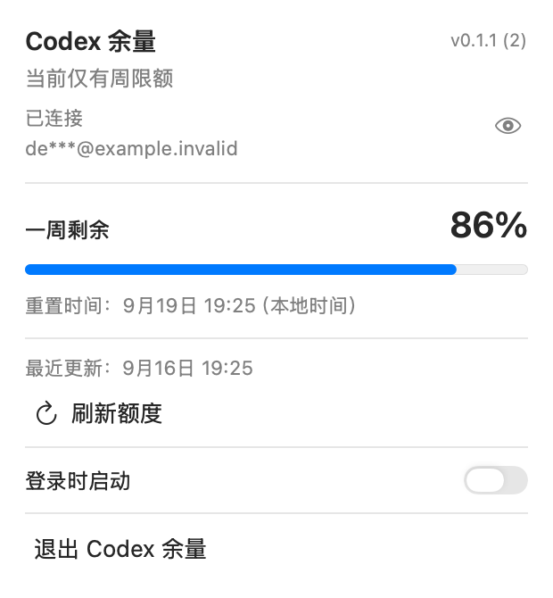
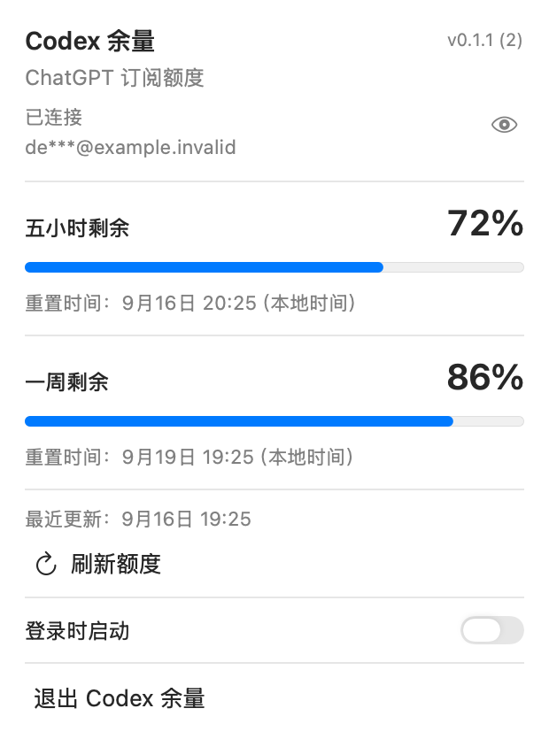

# Codex 余量

一个轻量的 macOS 菜单栏工具，抬眼就能看到 Codex 还剩多少额度。

**[下载 macOS App · v0.1.1 预览版](https://github.com/kale2222/CodexUsage/releases/download/v0.1.1/CodexUsage-0.1.1-macOS-arm64.zip)**

[所有版本](https://github.com/kale2222/CodexUsage/releases) · [问题反馈](https://github.com/kale2222/CodexUsage/issues)

- 五小时限额：`5h 72% · 22:29`
- 仅周限额：`7d 86%`，完整重置日期放在详情中。
- 默认约每 5 分钟更新，也支持手动刷新、账号核验和登录时启动。

百分比表示**剩余额度**，时间表示本地重置时刻。无需 Xcode 或自行编译。

## 界面预览


<p></p>

以上是运行中的原生 App 视图截图，使用演示账号与额度；截图采用纯色底方便阅读，实际浮层使用系统材质，不是 HTML 原型。

## 使用要求

- Apple Silicon Mac，macOS 26 或更新版本。
- 安装官方 ChatGPT / Codex 桌面应用或 Codex CLI。
- 使用具有 Codex 使用权限的 **ChatGPT 账号登录**，不是 API Key 登录。

本机已验证 macOS 26.5.2 和官方内附 Codex `0.154.0-alpha.6.2`。其他机器、组件版本及套餐仍需试用反馈；是否有可显示的窗口以官方实际返回为准。

## 安装与首次连接

1. 下载附件 **`CodexUsage-0.1.1-macOS-arm64.zip`**，解压后将 `CodexUsage.app` 拖入“应用程序”。
2. 如果还没有官方 Codex 组件，按下面的指引先安装并登录。
3. 打开本 App，点击菜单栏中的 ChatGPT 图标。已有可用登录时会直接显示额度；否则点击“连接 Codex”，在官方浏览器流程中登录。
4. 查看详情中的账号。点击眼睛按钮可显示完整邮箱，与官方应用的个人资料菜单核对。

请下载 Release 的 **App ZIP 附件**。`Source code (zip)` 和“Code → Download ZIP”仅包含本仓库的说明与截图，不是安装包。

<details>
<summary><strong>还没有安装官方 Codex 组件？</strong></summary>

**推荐桌面方式：**打开 [OpenAI 官方快速入门](https://developers.openai.com/codex/quickstart/)，选择 Desktop／桌面应用，下载 macOS 版本，安装到“应用程序”，启动后选择 ChatGPT 账号登录。只在浏览器登录 ChatGPT，并不代表本机已有 Codex 组件。

**已有 Homebrew 的用户也可以安装 CLI：**

```sh
brew install --cask codex
codex login
```

按浏览器提示使用 ChatGPT 账号登录，再打开本 App。这里不需要让 Codex 执行编程任务。

如果提示“未找到官方 Codex 程序”，点击“选择 Codex 程序…”，选择已安装的官方 `.app`，或官方 `codex` 可执行文件。若组件版本较旧，先更新官方应用／CLI 再重试。只选择来自官方的程序。

[官方 CLI 安装说明](https://github.com/openai/codex) · [官方登录说明](https://developers.openai.com/codex/auth/)

</details>

## 重要：按住 Command（⌘）拖动菜单栏图标

> **按住 Command（⌘），再用鼠标拖动菜单栏中的 ChatGPT 余量图标，就可以调整位置。**

拖到靠近时钟、容易看到的位置后松开鼠标，再松开 Command，应用会记住位置。

**使用 Hidden Bar？** 先点击箭头展开隐藏图标，再按住 **Command（⌘）**，将余量项移到**分隔线右侧的常显区**。找不到入口时，再次打开 App 也能找回详情窗口。

## 首次打开被 macOS 拦截？

当前为本地签名预览版，**尚未完成 Apple 公证**。若提示“无法验证开发者”或“Apple 无法检查此 App 是否包含恶意软件”，确认下载来自本仓库 Releases 后：

1. 尝试打开 App，然后关闭拦截提示。
2. 打开 **系统设置 → 隐私与安全性 → 安全性**。
3. 找到与 CodexUsage 相关的拦截记录，点击 **“仍要打开”**。
4. 按提示验证身份，并确认“打开”。

若没有相应按钮，或提示“App 已损坏”“将损坏你的电脑”，不要一概当作普通未公证提示；请重新下载并反馈具体错误。[Apple 官方说明](https://support.apple.com/zh-cn/102445)

## 账号与隐私

- 数据路径是 **本 App → 本机官方 Codex 组件 → 官方服务**。本 App 没有开发者后端，也没有内置遥测或自动上报。
- 读取的是 Codex 的 ChatGPT 账号限额，不是 API 余额、其他模型的独立额度或整个 ChatGPT 的通用消息额度。数字不是实时推送，可结合“最近更新”核对。
- 详情默认对邮箱脱敏，点击眼睛按钮才显示完整邮箱。关闭详情、切到其他应用、重新连接或读取失败后会恢复脱敏。失败后的旧身份会标为“上次账号”。
- 邮箱来自官方组件；若组件未提供邮箱，会明确提示无法核验。邮箱不能单独证明当前工作区，请同时在对应的官方组件中核对账号／工作区。
- 本 App 不主动将邮箱或额度写入磁盘，只保存菜单栏位置、所选程序路径等偏好。密码和 token 由官方组件管理；官方组件的缓存、日志及网络行为遵循其自身设置。
- 刷新时读取账号与额度；点击连接时会发起官方登录流程，可能写入或更新官方组件的共享登录缓存。不会启动模型任务；这**不代表**获得了独立的“只读余量权限”凭据。退出或卸载本 App 不会退出官方组件的共享账号。

<details>
<summary><strong>登录失败、账号不符或额度不一致怎么办？</strong></summary>

登录取消、超时或失效时，可以重新点击“连接 Codex”。取消连接只停止本次等待，不是注销官方账号。

如果显示的邮箱不符，桌面用户可在对应官方应用的个人资料菜单退出并登录正确账号；CLI 用户可使用 `codex logout` 后再运行 `codex login`。共享登录变化可能同时影响其他官方客户端。

完成外部登录后，退出并重新打开本 App，让它重新检测登录。若仍提示未连接，可点击“连接 Codex”再完成一次官方登录流程。不要删除或上传 `auth.json` 来排障。

请与**同一账号／工作区、相近更新时间**的官方 Codex 用量核对。未返回或无法识别的数据会显示不可用，不能据此推断不限额。Free 等套餐是否能显示，以官方为该账号返回的限额为准，目前未逐一验证所有套餐。

断网时保留上次成功数据并显示异常标记，恢复后可手动刷新。截图分享前请保持账号脱敏。

</details>

## 更新与卸载

**更新：**在旧版弹窗中选择“退出 Codex 余量”，下载新版 App 并替换“应用程序”中的旧副本，再打开。详情右上角可核对版本与构建号，例如 `v0.1.1 (2)`。保留原安装路径，更新后检查“登录时启动”；预览版可能再次出现系统拦截提示。

**回退：**退出当前版本，从 Releases 下载旧版，在同一位置替换后打开。不同版本的偏好兼容性尚未全面验证。

**卸载：**先关闭“登录时启动”（若设置失败，到系统设置的登录项中确认），然后退出 App，将 App 移到废纸篓。关闭详情窗口本身不会退出后台。系统可能保留本工具偏好；卸载本工具不需要删除官方 Codex 组件或它的登录凭据。

## 反馈问题

在 [Issues](https://github.com/kale2222/CodexUsage/issues) 中提供：App 版本、macOS／芯片、官方组件名称与版本、首次使用还是更新后发生、操作步骤、错误提示及脱敏截图。

**不要提交密码、token、`auth.json` 或完整授权 URL。** 本版仍为预览版，另一台全新 Mac 的首次安装和登录、长期睡眠／自启行为尚待进一步验证。

---

本仓库仅提供 App、使用说明和截图，不公开应用源码。非 OpenAI 官方项目；ChatGPT 图形标识归 OpenAI 所有。
